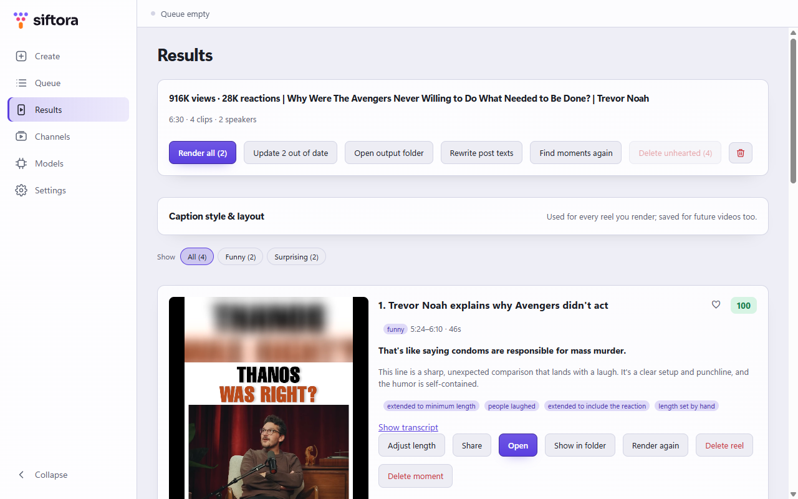
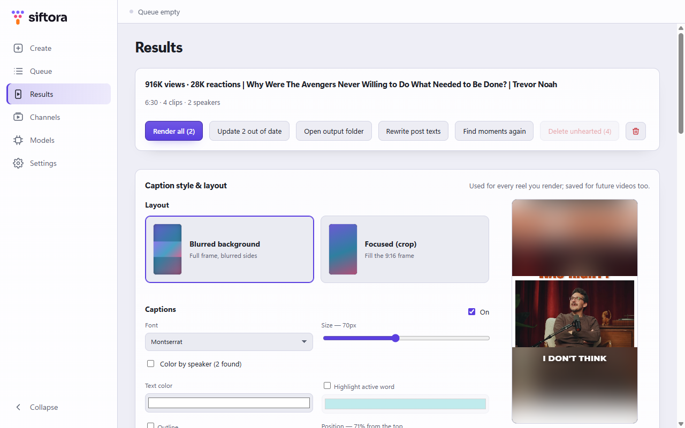
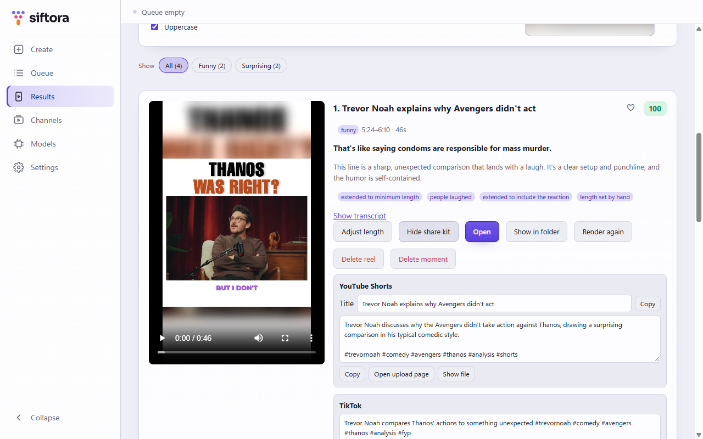
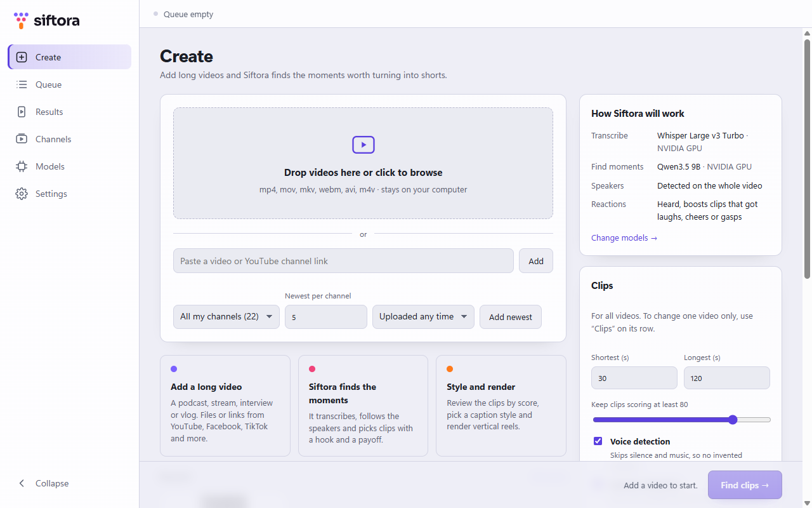

<p align="center">
  <picture>
    <source media="(prefers-color-scheme: dark)" srcset="resources/brand/siftora-horizontal-on-dark.svg">
    
  </picture>
</p>

<p align="center"><strong>Sift your long videos for the moments worth sharing.</strong><br><a href="https://mohamedkrs.github.io/siftora/">Visit the website</a></p>

<p align="center">
  <a href="../../releases/latest/download/Siftora-Setup.exe"></a>
  &nbsp;
  <a href="../../releases/latest/download/Siftora-mac-arm64.dmg"></a>
  &nbsp;
  <a href="https://ko-fi.com/mohamedkrs"></a>
</p>

Siftora is a free, open-source AI clip maker that turns long videos (podcasts, streams, interviews, vlogs) into vertical clips for TikTok, Instagram Reels and YouTube Shorts. It transcribes the video, finds the moments with a hook, a setup and a payoff, and renders them as 1080×1920 reels with animated captions. Think of it as an open-source alternative to Opus Clip that runs on your own PC, with no subscription.

Everything runs on your own computer. Your videos and transcripts are never uploaded.

<p align="center">
  <picture><source media="(prefers-color-scheme: dark)" srcset="site/screenshots/results-dark.png"></picture>
</p>

<table>
  <tr>
    <td width="33%"><picture><source media="(prefers-color-scheme: dark)" srcset="site/screenshots/captions-dark.png"></picture></td>
    <td width="33%"><picture><source media="(prefers-color-scheme: dark)" srcset="site/screenshots/share-dark.png"></picture></td>
    <td width="33%"><picture><source media="(prefers-color-scheme: dark)" srcset="site/screenshots/create-dark.png"></picture></td>
  </tr>
  <tr>
    <td align="center">Captions with a live preview</td>
    <td align="center">Post texts for every platform</td>
    <td align="center">Add files, links or channels</td>
  </tr>
</table>

<sub>Screenshots show <a href="https://www.facebook.com/share/v/1Cf4mHV4Eq/">"Why Were The Avengers Never Willing to Do What Needed to Be Done?"</a> by Trevor Noah, who does not endorse Siftora.</sub>

## Features

- **Finds the moments for you.** A local AI model reads the whole transcript and picks clips with a real payoff, scored and explained. It is told to start where the setup starts, not to treat swearing as a hook, and to quote the payoff word for word, so clips are not cut off or invented.
- **Accurate captions.** Word-by-word timing from Whisper, voice detection so silence and music do not turn into made-up lines, and four caption fonts with an optional highlight on the spoken word.
- **Hears the room.** Optional reaction detection picks up laughter, applause and cheering, and YouTube's "Most replayed" graph gives a boost to the parts viewers rewatch.
- **Colour per speaker.** Optional speaker detection gives each person their own caption colour.
- **Review fast.** Filter moments by topic (funny, emotional, educational…), heart the keepers and delete the rest in one click.
- **Fine-tune the length.** Drag the ends of the clip on a timeline (the AI's cut stays outlined), click a transcript word to start the clip on it or Shift+click to end it there, or play and press I / O. The player jumps to every new start or end, and **Bigger** opens a large player with the editor under it.
- **Preview before you render.** Pick the caption style and layout on a real frame of your clip, drag the captions where you want them (or turn them off), then render one reel or all of them.
- **Ready to post.** Each rendered reel comes with a title, description and hashtags per platform, written with the video's chapters, the creator's own hashtags and a credit to their channel. Optionally, Siftora also reads the YouTube comments that point at a moment ("14:22 I lost it") to find the angle viewers loved.
- **Know what's left to post.** Mark a reel as posted when you've uploaded it. **To post** in the sidebar lists every rendered reel you haven't posted yet, across all your videos, with its share kit; on Results, filter a video's moments by posted or not.
- **Uses what you already have.** Finds Ollama, Python Whisper, FFmpeg and model files on your computer, so you download as little as possible.
- **Files or links.** YouTube, Facebook, TikTok, X, Instagram and the many other sites [yt-dlp](https://github.com/yt-dlp/yt-dlp) supports. Clip length and score limits can be set for all videos or per video. The longest length is a hard cap; the shortest is a target, so a complete moment a little under it is kept as is, not padded. Paste a YouTube channel link to add its newest videos (1 to 50), optionally only those uploaded in the last day, week or month; ones Siftora already has are skipped.
- **Your channels, one click.** Save favourite YouTube channels on **Channels** and group them with as many tags as you like (gaming, podcasts…); the tag box suggests the tags you already use as you type. Paste a channel link and its name and tags fill in by themselves, or pick channels from your YouTube subscriptions (needs the YouTube sign-in from Settings). On Create, pick a tag, one channel or all of them to add each one's newest videos with your current settings; videos Siftora already has are skipped.

## Requirements

- **Windows 10 or 11, 64-bit**, or **macOS 13.3 or newer** (Apple Silicon; Intel Macs work more slowly). The macOS version is new and less tested; Linux should work but is untested. See [Platforms](#platforms).
- **8 GB of RAM** at least. 16 GB or more is better.
- **An NVIDIA graphics card is strongly recommended.** It makes Siftora 5–10 times faster. Other graphics cards work through Vulkan, and any computer works on the CPU, more slowly.
- **3–12 GB of free disk space** for the engines and AI models, depending on which you choose.

## Install

**Windows**

1. Click **Download for Windows** above, or pick a version on the [Releases](../../releases) page.
2. Run it. Windows may show "Windows protected your PC", because the app is not code-signed yet: choose **More info → Run anyway**. Accept the license, choose whether to install for just you or everyone on the computer, and pick a folder. Downloaded models still go to your user's app data folder. The last page can start Siftora and has links to this README, the changelog and Ko-fi.

**macOS**

1. Click **Download for macOS** above. On an Intel Mac, download [Siftora-mac-x64.dmg](../../releases/latest/download/Siftora-mac-x64.dmg) instead.
2. Open the disk image and drag Siftora into **Applications**.
3. Open Siftora. macOS says it cannot check the app for malware, because it is not notarized by Apple yet: click **Done**, then open **System Settings → Privacy & Security**, scroll down and click **Open Anyway** next to Siftora. You only do this once.

   If macOS instead says the app "is damaged", run `xattr -cr /Applications/Siftora.app` in Terminal and open it again.

**Then, on both**

On first start, Siftora checks your hardware, recommends models that fit it, and shows what it found already on your computer. Then it downloads what is missing.

## How to use it

New to Siftora? A **Getting started** checklist at the top of Create ticks off the first steps as you do them and goes away when you are done (hide it any time; **Settings → Setup** brings it back).

1. **Create:** drop in a video, paste a link or a YouTube channel link, then **Find clips**. Add as many as you like; the sidebar shows how many are still to do. If you add a video Siftora already has, it offers to open its results instead (or add it again anyway).
2. **Queue:** follow the progress. Finished steps are saved, so a retry does not start over. **Pause all** pauses every waiting video and stops the running one, which continues from its last finished step when resumed; **Resume all** starts them again. **Pause** or **Resume** single videos (or several ticked ones) too. Videos left unfinished when you close Siftora come back paused. Switch between a **List** and a **Grid** of cards at the top. Filter the list by status, channel or when you added the video. Tick videos (or **Select all**) to find moments again, retry or delete them in one go; the same works on Results.
3. **Results:** pick a video (filter them by channel or date added), review its clips by score, pick a caption style and layout, and render the reels. They are saved in `Videos\Siftora`.

Age-restricted or members-only videos need your sign-in: in **Settings → Video links**, choose the browser you are signed in with (Firefox works best) or load a `cookies.txt` file. On Windows, Chrome, Edge, Brave and other Chrome-based browsers lock their sign-in so other apps usually can't read it: export a `cookies.txt` from them with a "cookies.txt" browser extension instead. Export it from a private (incognito) window you signed in to, and close that window right after: YouTube replaces the sign-in of open tabs, so a file exported from your normal window stops working within days. Siftora only uses it when a site asks for it.

Scores are estimates to help you choose. They do not guarantee that a clip will do well. Roughly: 60 is a good clip, 80 stands out, 90+ is rare. Moments found by Siftora 0.3 and earlier used a looser scale, so their scores run higher; **Find moments again** rescores them.

## Privacy

- Your videos, transcripts and clips **never leave your computer**. There is no account, no tracking and no analytics.
- Siftora goes online only to download its engines and AI models (from GitHub and Hugging Face), to check for engine updates and, once per start, for a newer Siftora (on GitHub; turn it off in **Settings → About**), and to download the videos you add by link (and their comments, if you turn that on).
- If you choose a sign-in for video links, your browser's cookies (or your `cookies.txt`) are passed to yt-dlp on your computer, and only sent to the site of the video.
- What you do with found moments (hearts, deletes, trims, renders) is written to `feedback.jsonl` in the app's data folder, so you can measure how good the picks are. It stays there.
- If you point Ollama at another computer (its `OLLAMA_HOST` setting), transcripts are sent to that computer for the clip-finding step.

## Removing Siftora

- **Windows:** uninstall it from **Settings → Apps**. You are asked whether to also delete the downloaded models and settings.
- **Any system:** **Settings → Storage** in the app shows how much space it uses and can delete the engines and models, or remove all its data before you delete the app.

Your rendered reels are never deleted by either.

## Platforms

| | Windows | Linux | macOS |
|---|---|---|---|
| Status | Tested | Should work, untested | Tested on Apple Silicon (M3 Pro); Intel untested |
| Fast transcription | NVIDIA GPU | CPU only for now | Apple Silicon (Metal) |

### Tested on

So far Siftora has been tested on one computer:

| | |
|---|---|
| System | Windows 11 Pro, 64-bit |
| Processor | Intel Core i9-11900KF (8 cores) |
| Memory | 16 GB |
| Graphics | NVIDIA GeForce RTX 4060 Ti, 16 GB (driver 621) |

**More testing is needed**, especially on:

- graphics cards with less memory (6–8 GB) and older NVIDIA cards
- AMD and Intel graphics (Vulkan), and computers without a graphics card (CPU only)
- 8 GB of RAM
- Windows 10
- Linux and macOS

If you try it on another setup, please fill in a [test report](../../issues/new?template=test_report.yml): your computer, which models you used, how long a video took and how it went, even if everything worked.

## Building from source

```sh
npm install
node node_modules/electron/install.js   # npm 11 blocks Electron's own install script
npm run dev
```

Also available: `npm run typecheck`, `npm run build`, and `npm run dist` to build the installer into `release/`. If Electron starts as plain Node from a VS Code terminal, unset `ELECTRON_RUN_AS_NODE`.

The app is Electron, React and TypeScript. The work happens in `src/main/pipeline`: transcription (`transcribe.ts`), speaker detection (`speakers.ts`), reaction detection (`reactions.ts`), finding moments (`discover.ts`) and rendering (`render.ts`).

### Measuring the picks

`npm run eval` reads `feedback.jsonl` and reports, per AI model and finder version: precision@3/5/10 (share of the top moments you kept), acceptance, how far you moved the start and end, and duplicates. Only videos you reviewed count. Bump `FINDER_VERSION` in `discover.ts` whenever you change the prompt, so versions can be compared. Options: `npm run eval -- path/to/feedback.jsonl --k 3,5`.

### Releasing

For the maintainer: these steps need write access to this repository. In a fork, the same workflow makes releases in your own copy only.

1. Set the new version in `package.json` and commit it.
2. Open **Actions → Release → Run workflow** and choose what to do:
   - **Only build:** builds the installer as a download on the run, without releasing anything.
   - **Draft release:** builds it and creates a draft release. Review it, add notes and publish it yourself.
   - **Publish release:** builds it and publishes the release right away.
3. Once published, the **Download for Windows** button serves the new version.

[.github/workflows/release.yml](.github/workflows/release.yml) builds on a clean Windows machine. Publishing from the workflow creates the version tag, so if a tag ruleset protects `v*` tags, it must allow creating them (keep updates and deletions restricted); a draft creates no tag until you publish it. Pushing a matching tag (`git tag v0.2.0`, then `git push --tags`) also makes a draft.

### Engine updates

Engines are downloaded on demand, never bundled. Besides the built-in list in `src/shared/engines.ts`, the app reads a tested list, `engines.json`, from this repository's `engines` release, and offers an **Update** on the Models screen when a newer tested version exists.

[.github/workflows/engines.yml](.github/workflows/engines.yml) keeps that list current: on demand, or weekly once the repository variable `ENGINES_WEEKLY` is set to `true`, it picks up a new whisper.cpp release, smoke-tests the Windows build with the app's own settings ([scripts/engines/smoke-whisper.mjs](scripts/engines/smoke-whisper.mjs)), builds and smoke-tests whisper-cli for macOS (upstream has no macOS build), and publishes only if all of that passes. Run it once from the Actions tab: until then, Macs have no whisper.cpp to download. A fork must set `ENGINE_REPO` in `src/shared/engines.ts` to its own `owner/repo`.

The original design notes are in [docs/planning](docs/planning).

## Support Siftora

Siftora is free, with no ads, accounts or subscriptions. If it saves you editing time, you can buy me a coffee on Ko-fi (no account needed). Testing on other computers helps just as much: see [Tested on](#tested-on).

<a href="https://ko-fi.com/mohamedkrs"></a>

## Contributing

Bug reports, ideas and pull requests are welcome: see [CONTRIBUTING.md](CONTRIBUTING.md) and the [code of conduct](CODE_OF_CONDUCT.md). Please report security problems privately, as described in [SECURITY.md](SECURITY.md).

## License

Siftora is free software under the [GNU GPL v3](LICENSE).

The Siftora name and logo are not covered by the GPL. You are welcome to fork and modify Siftora under its license, but please give a modified version that you publish its own name and logo, so people can tell it apart from the original. Using the name to refer to Siftora itself, for example in a review or tutorial, is fine.

It builds on [whisper.cpp](https://github.com/ggml-org/whisper.cpp) and [llama.cpp](https://github.com/ggml-org/llama.cpp) (MIT), [FFmpeg](https://ffmpeg.org) (GPL), [sherpa-onnx](https://github.com/k2-fsa/sherpa-onnx) (Apache 2.0), [yt-dlp](https://github.com/yt-dlp/yt-dlp) (Unlicense), OpenAI's Whisper models (MIT), the CED audio tagger (Apache 2.0), Qwen models (Apache 2.0), Silero VAD (MIT), and the caption fonts listed in [resources/fonts](resources/fonts/README.md) (SIL Open Font License). The engines and models are downloaded from their publishers when you need them.
